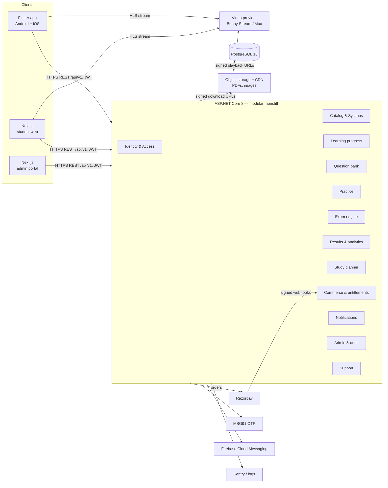

# Architecture

## System diagram



## Decisions

| Decision | Choice | Why |
|---|---|---|
| Backend style | Modular monolith (one deployable, folders per module, no cross-module DB writes except via services) | Small team, one DB, cheap to host; modules can be extracted later |
| DB | PostgreSQL only | Free, JSONB for question snapshots, FTS for later search |
| Auth | JWT access token (15 min) + opaque rotating refresh token (30 days, SHA-256 hashed at rest) | Works identically on mobile and web |
| Password hashing | BCrypt (work factor 11) | Established library |
| Video | Third-party HLS provider, DB stores only provider video ID | No large files in DB; provider handles transcoding/CDN |
| Timing | Server stores `StartedAt` and `ExpiresAt`; client timer is cosmetic | Prevents client clock tampering |
| Scoring | Pure function over immutable question snapshots captured when the attempt starts | Reproducible, unit-testable |
| Randomization | Seeded shuffle (seed stored per attempt) | Same order on reconnect |
| Idempotency | Unique constraints (`PaymentWebhookEvents.EventId`, one result per attempt) + status checks inside transactions | Duplicate submits/webhooks are no-ops |
| Redis | Not in MVP | Add only when profiling shows a need |
| Mobile | Flutter (Riverpod, Dio, go_router, intl ARB files) | One codebase for Android + iOS |
| Web | Next.js App Router + TypeScript; admin is a route group with role guard | One deploy for student web + admin |
| Shared contracts | OpenAPI spec generated by Swashbuckle → `openapi-generator` for Dart and TS clients | Single source of truth |

## Backend layout

```
src/LearnPath.Api/
  Domain/          entities + enums (one file per module)
  Data/            AppDbContext, migrations, seeder
  Modules/<Name>/  controller(s) + service(s) + DTOs
  Infrastructure/  JWT, clock, payment gateway, OTP sender, video URL signer, error handling
```

## Security model
- Roles: `Student`, `Teacher`, `ContentAdmin`, `Support`, `Finance`, `Analyst`, `SuperAdmin`.
- Students never receive `IsCorrect`, answer keys or explanations before an attempt is submitted (DTOs exclude them).
- Paid resources/tests go through `EntitlementService.HasAccessAsync` server-side.
- Rate limiting on `/auth/*` (fixed window per IP).
- Admin mutations write `AuditLogs` rows.
- Secrets only from environment variables; none in `appsettings.json`.
