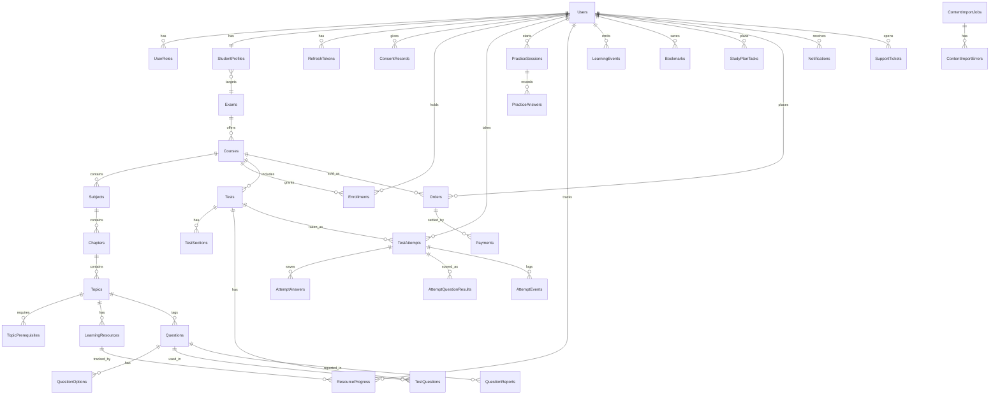

# Data Model

PostgreSQL 16, managed through EF Core migrations (`src/LearnPath.Api/Data/Migrations`). The full DDL generated
from the migrations is in [`schema.sql`](schema.sql). Keys are UUIDs (append-only logs use `bigint` identities).

## ER diagram (core relationships)



Standalone: `PaymentWebhookEvents` (unique `EventId`), `AuditLogs`, `OtpCodes`.

## Mapping to the requested entity list

| Requested | Implemented as | Note |
|---|---|---|
| Users, Roles, UserRoles | `Users`, `UserRoles` (role names are constants) | Roles table unnecessary for fixed role set |
| StudentProfiles, StudentPreferences, StudentExamTargets | `StudentProfiles` | One target exam per student in MVP; split when multi-exam is needed |
| UserSessions | `RefreshTokens` | Hashed, rotating |
| ConsentRecords | `ConsentRecords` | Terms, privacy, guardian |
| Examinations, Boards, Classes | `Exams`; board/class are columns on `Courses`/`StudentProfiles` | Promote to tables if filtering grows |
| SyllabusUnits | `Chapters.UnitTitleEn` | Optional grouping label; full table in P1 if needed |
| Videos, Documents | `LearningResources` (`Type` = Video/Document) | Video = provider ID only |
| ContentVersions | `Version` column on `Questions` and `LearningResources` + attempt snapshots | Full history table in P1 |
| QuestionAnswers, QuestionExplanations | Columns on `Questions` / `QuestionOptions.IsCorrect` | |
| QuestionTopicMappings, QuestionTags | `Questions.TopicId` | Many-to-many tags in P1 |
| TestResults | Score columns on `TestAttempts` + `AttemptQuestionResults` | One result per attempt by construction |
| LearningProgress, VideoWatchProgress, TopicCompletion | `ResourceProgress` | Topic completion derived from resources |
| RevisionItems, StudentLearningHistory | `Bookmarks`, `LearningEvents`, incorrect-answer queries | Revision due-dates in P1 |
| StudyPlans, StudyPlanTasks | `StudyPlanTasks` (grouped by `PlanDate`) | |
| ProductsOrCourseOffers, Subscriptions, Coupons | Price on `Courses` | P1 (subscriptions/coupons) |
| ApplicationEvents | `LearningEvents`, `AttemptEvents`, `AuditLogs` | |

## Integrity rules enforced in the database

- Unique: user email/phone (when present), exam code, course slug, question `ExternalRef`, `(UserId, CourseId)` enrollment,
  `(TestId, QuestionId)`, `(TestId, UserId, AttemptNumber)`, gateway order/payment IDs, webhook `EventId`, bookmark per entity.
- `TestAttempts.SnapshotJson` (jsonb) freezes question text, options, keys, marks and taxonomy at start; scoring and
  review read only from it, so later edits never change a past result.
- Row locks (`SELECT … FOR UPDATE`) serialise save/submit on an attempt and payment settlement on an order.
- Deleting content that has been used is restricted (`ON DELETE RESTRICT` from questions/tests/orders); archive instead.

## Migrations

```bash
dotnet tool install --global dotnet-ef --version 8.0.10
dotnet ef migrations add <Name> -p src/LearnPath.Api -o Data/Migrations
dotnet ef migrations script --idempotent -p src/LearnPath.Api -o deploy/migrate.sql   # review before production
```
The API applies pending migrations on start (`Database:MigrateOnStartup`). In production, set it to `false` and run the
reviewed idempotent script as a release step.
