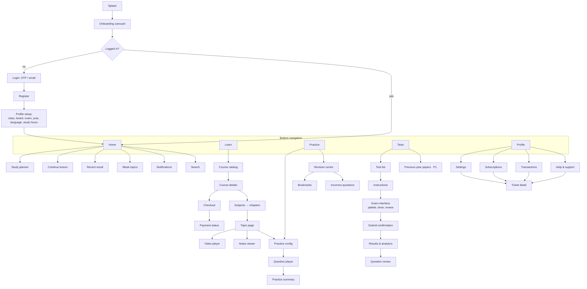

# Screen Inventory & Navigation Map



## Admin portal (web)

```
/admin/login
/admin                 dashboard (counts, attempts, payments, reported issues)
/admin/catalog         exams → courses → subjects → chapters → topics → resources (tree editor)
/admin/questions       question bank list, filters, editor, CSV import (P1)
/admin/tests           test builder (pick questions, marks, negative marks, duration, shuffle)
/admin/students        search, status, enrollments
/admin/orders          orders, payments, refunds
/admin/support         tickets, question reports
/admin/audit           audit log viewer
```

## Design system (original — no Embibe assets)

| Token | Value |
|---|---|
| Primary | `#4F46E5` (indigo 600) |
| Accent | `#F59E0B` (amber 500, streaks/highlights) |
| Success / Error | `#16A34A` / `#DC2626` |
| Surface / Background | `#FFFFFF` / `#F7F7FB`; dark: `#1A1B26` / `#0F1018` |
| Radius | 12 px cards, 8 px inputs, 999 px chips |
| Spacing scale | 4, 8, 12, 16, 24, 32 |
| Type | Noto Sans + Noto Sans Devanagari (covers Hindi), 14/16/20/24/32 |
| Touch target | ≥ 48 dp |

Reusable components: `AppButton`, `ProgressRing`, `TopicTile`, `QuestionCard`, `OptionTile`, `QuestionPalette`,
`CountdownTimer`, `StatTile`, `EmptyState`, `ErrorState`, `SkeletonList`, `PaywallSheet`.
Every list screen implements loading (skeleton), empty, error (retry) and offline states.
